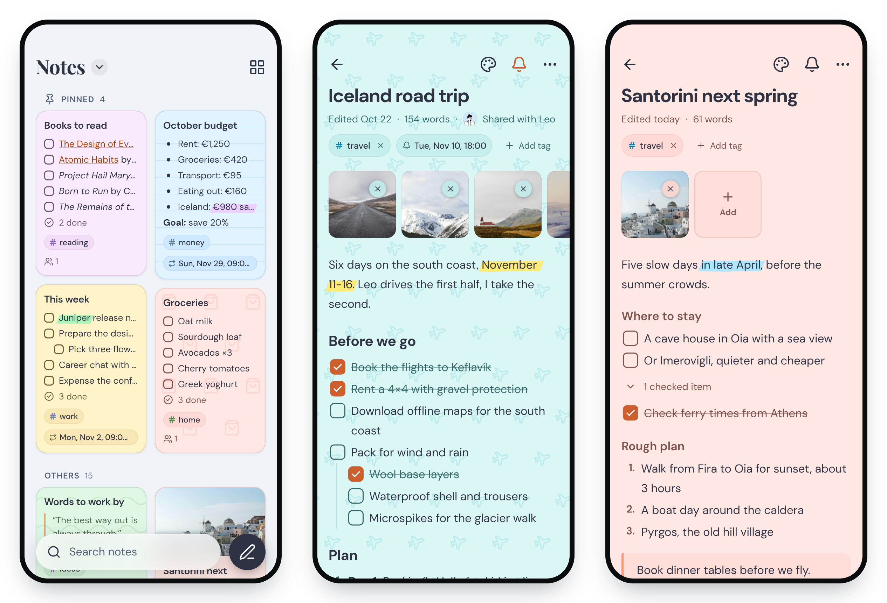
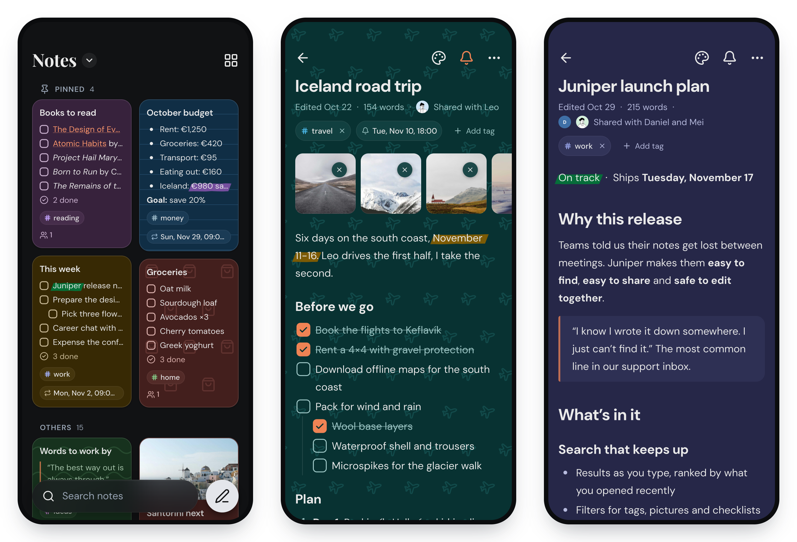

<div align="center">


# Anchor

**An offline first, self hostable note taking application**

[](https://github.com/zhfahim/anchor/releases)
[](LICENSE)
[](https://github.com/zhfahim/anchor)
[](https://discord.gg/sAfqjy8EYK)

<a href="https://trendshift.io/repositories/18646" target="_blank"></a>

Anchor focuses on speed, privacy, simplicity, and reliability across mobile and web. Notes are stored locally, editable offline, and synced across devices when online.

<a href="https://play.google.com/store/apps/details?id=com.zhfahim.anchor"></a>
<a href="https://testflight.apple.com/join/5982frnz"></a>

</div>

## Features

- **Rich Text Editor** - Create and edit notes with powerful formatting (bold, italic, underline, highlights, headings, lists, checkboxes), or type / to pick a format
- **Offline First** - All edits work offline with local database
- **Note Sharing** - Share notes with other users (viewer or editor), or with anyone through a read-only link
- **Note History** - Read earlier versions of a note and put one back
- **Tags System** - Organize notes with custom tags and colors
- **Attachments** - Attach images and audio to notes
- **Note Backgrounds** - Customize notes with solid colors and patterns
- **Pin Notes** - Pin important notes for quick access
- **Archive Notes** - Archive notes for later reference
- **Reminders** - Set a time on any note and get a notification on your phone, once or repeating
- **Search** - Search notes locally by title or content, archived notes included
- **Share to Anchor** - Save text, links and pictures from other apps on your phone
- **Trash** - Soft delete notes with recovery period
- **Automatic Sync** - Sync changes across devices when online
- **Import & Export** - Back up your full library, move notes in and out as plain Markdown, or bring them over from Google Keep
- **Home Screen Widget** - Quick access to your notes from the Android home screen
- **Admin Panel** - User management, registration control, and system statistics
- **OIDC Authentication** - Sign in with OpenID Connect providers (Pocket ID, Authelia, Keycloak, etc.)

## Screenshots

### Web App

<div align="center">
  
  
</div>

### Mobile App

<div align="center">
  
  
</div>

## Self Hosting With Docker

### Option 1: Using Pre-built Image (Recommended)

1. **Create a `docker-compose.yml` file:**

   ```yaml
   services:
     anchor:
       image: ghcr.io/zhfahim/anchor:latest
       container_name: anchor
       restart: unless-stopped
       ports:
         - "3000:3000"
       volumes:
         - anchor_data:/data

   volumes:
     anchor_data:
   ```

2. **(Optional) Configure environment:**
   Add environment variables to the `environment` section. Most users can skip this step - defaults work out of the box.

   Available options:
   | Variable | Required | Default | Description |
   |----------|----------|---------|-------------|
   | `APP_URL` | No | `http://localhost:3000` | Base URL where Anchor is served |
   | `JWT_SECRET` | No | (auto-generated) | Auth token secret. Min 16 characters when set |
   | `DATA_DIR` | No | `/data` | Root directory for persisted uploads |
   | `CORS_ORIGINS` | No | (allow all) | Comma-separated allowlist of CORS origins |
   | `PG_HOST` | No | (empty) | External Postgres host (leave empty for embedded) |
   | `PG_PORT` | No | `5432` | Postgres port |
   | `PG_USER` | No | `anchor` | Postgres username |
   | `PG_PASSWORD` | No | `password` | Postgres password |
   | `PG_DATABASE` | No | `anchor` | Database name |
   | `USER_SIGNUP` | No | (not set) | Sign up mode: `disabled`, `enabled`, or `review`. If not set, admins can control it via the admin panel |
   | `OIDC_ENABLED` | No | (not set) | Enable OIDC authentication |
   | `OIDC_PROVIDER_NAME` | No | `"OIDC Provider"` | Display name for the login button |
   | `OIDC_ISSUER_URL` | When OIDC enabled | (not set) | Base URL of your OIDC provider |
   | `OIDC_CLIENT_ID` | When OIDC enabled | (not set) | OIDC client ID |
   | `OIDC_CLIENT_SECRET` | No | (not set) | OIDC client secret. Omit for public client (PKCE) |
   | `DISABLE_INTERNAL_AUTH` | No | `false` | Hide local login form when OIDC is enabled (OIDC-only mode) |

3. **Start the container:**

   ```bash
   docker compose up -d
   ```

4. **Access the app:**
   Open http://localhost:3000

### Pre-release (Beta) Image

To test upcoming features before they are officially released, use the `next` tag:

```yaml
services:
  anchor:
    image: ghcr.io/zhfahim/anchor:next
    container_name: anchor
    restart: unless-stopped
    ports:
      - "3000:3000"
    volumes:
      - anchor_data:/data

volumes:
  anchor_data:
```

> **Warning:** The `next` image is built from the `next` branch and may contain incomplete features or breaking changes. Do not use it in production. Back up your data before switching.

### Option 2: Building from Source

If you want to build from source or customize the image:

1. **Clone the project:**

   ```bash
   git clone https://github.com/zhfahim/anchor.git
   cd anchor
   ```

2. **Start the container:**

   ```bash
   docker compose up -d
   ```

   The `docker-compose.yml` file will build the image from source automatically.

## Mobile App

The mobile app works with your Anchor server. Set up the server first, then sign in with its address.

### Android

<a href="https://play.google.com/store/apps/details?id=com.zhfahim.anchor"></a>
<a href="https://github.com/zhfahim/anchor/releases/latest"></a>

Each GitHub release has these APK files:

- **Universal APK** (`anchor-{version}.apk`) - Recommended for most users, works on all devices
- **Architecture-specific APKs** - Smaller file sizes for specific CPU architectures

### iPhone and iPad

The iOS app is in beta on TestFlight. Install [TestFlight](https://apps.apple.com/app/testflight/id899247664) from the App Store, then open the [Anchor beta link](https://testflight.apple.com/join/5982frnz) on your iPhone or iPad.

## OIDC Authentication

Anchor supports OpenID Connect (OIDC) authentication for simplified credential management and streamlined multi-user deployments.

### Features

- Support for standard OIDC providers (Pocket ID, Authelia, Authentik, Keycloak, etc.)
- Configuration via environment variables or admin settings UI
- OIDC only mode: disable local username/password login
- Support for public OIDC clients (PKCE, no client secret required)
- Auto create users on first login (if user signup is not disabled)
- Auto link existing users by email

### Configuration

#### Mobile app and Public client

If you want to use OIDC in the mobile app, configure Anchor as a **Public client** (PKCE, no client secret) in your OIDC provider. Add this redirect URI in your OIDC provider:

```
anchor://oidc/callback
```

#### Required Callback URL (Web)

When configuring your OIDC provider for web login, add this callback/redirect URL:

```
{APP_URL}/api/auth/oidc/callback
```

For example, if your Anchor instance is at `https://notes.example.com`, the callback URL would be:

```
https://notes.example.com/api/auth/oidc/callback
```

#### Environment Variables

Configure OIDC via environment variables in your `docker-compose.yml`. Pocket ID example:

```yaml
services:
  anchor:
    image: ghcr.io/zhfahim/anchor:latest
    environment:
      - OIDC_ENABLED=true
      - OIDC_PROVIDER_NAME=Pocket ID
      - OIDC_ISSUER_URL=https://pocketid.example.com
      - OIDC_CLIENT_ID=your-client-id
      - OIDC_CLIENT_SECRET=your-client-secret # Optional for public clients
      - DISABLE_INTERNAL_AUTH=false
      - APP_URL=https://notes.example.com
```

#### Admin UI Configuration

Alternatively, configure OIDC in the admin panel (Admin → Sign-in → Single sign-on) when the three env vars are not all set.

## Backup and Restore

Log into your Anchor deployment, go to **Settings**, scroll to **Import and export**, click **Export** and choose **Anchor backup (.zip)**.

The resulting `anchor-export-YYYY-MM-DD.zip` contains:

- `manifest.json` which includes the backup metadata, tags, notes, and attachment references in plain text
- the referenced attachments, stored within the `attachments` folder structure

To restore, go to the same section, click **Import** and pick that file. Import also takes Google Keep exports and Markdown files from Obsidian and Nextcloud Notes.

## Troubleshooting & Collecting Logs

Anchor never collects any data. When you need to report a bug, you can collect logs yourself and share them with the maintainer.

**Mobile app**

1. Reproduce the issue.
2. Open Settings → Logs.
3. Tap **•••**, choose **Save to a file**, then attach the saved `.log` file to your bug report.

> Sensitive values are stripped before anything is written to the log file. This includes authorization headers, passwords, tokens, refresh tokens, secrets, and email addresses, which are always replaced with `***`.

Logs are stored locally on the device only (rolling, ~2 MB max).

## Roadmap

Future planned features:

- Real-time collaboration

## Tech Stack

- **Backend**: Nest.js, PostgreSQL, Prisma
- **Mobile**: Flutter (Android and iOS)
- **Web**: Next.js, TypeScript

## Contributing

1. Fork the repository
2. Create a feature branch:
   ```bash
   git checkout -b feature/your-feature
   ```
3. Make your changes
4. Ensure builds pass and code is linted:
   - Web: `cd web && pnpm build && pnpm check`
   - Server: `cd server && pnpm build && pnpm check`
   - Mobile: `cd mobile && flutter analyze && flutter test`
5. Commit changes:
   ```bash
   git commit -m "Describe your change"
   ```
6. Push and create a Pull Request

### Code style

Linting and formatting are enforced in CI and by a pre-commit hook
(`.githooks/pre-commit`) that checks staged files.
Running `pnpm install` in either `web` or `server`
enables the hook automatically (via the `prepare` script). To enable it manually:

```bash
git config core.hooksPath .githooks
```

Before committing, fix issues with `pnpm check:fix` in the relevant project.

### Design tokens

The web app's colors, text sizes, spacing, corners, shadows and motion live in
`design/tokens/` (W3C Design Tokens format). `web/app/styles/tokens.css`,
`web/app/styles/notes.css` and `web/lib/design/tokens.ts` are built from them,
so change the tokens rather than those files. After changing a token, run this
from the repository root (it reads icons from `web/node_modules`, so run
`pnpm install` in `web` first):

```bash
node design/build/build.mjs
```

CI runs it with `--check` and fails if the built files are out of date.

## Community

Questions, bugs or ideas? Join us on [Discord](https://discord.gg/sAfqjy8EYK) or [open an issue](https://github.com/zhfahim/anchor/issues).

## Support

If you find Anchor useful, consider supporting its development:

[](https://www.buymeacoffee.com/zahid)

### Sponsors

Thank you to our sponsors. [Become a sponsor](https://buymeacoffee.com/zahid/membership).

<a href="https://github.com/heydabop"></a>

## License

This project is licensed under the GNU Affero General Public License v3.0 (AGPL v3) - see the [LICENSE](LICENSE) file for details.
