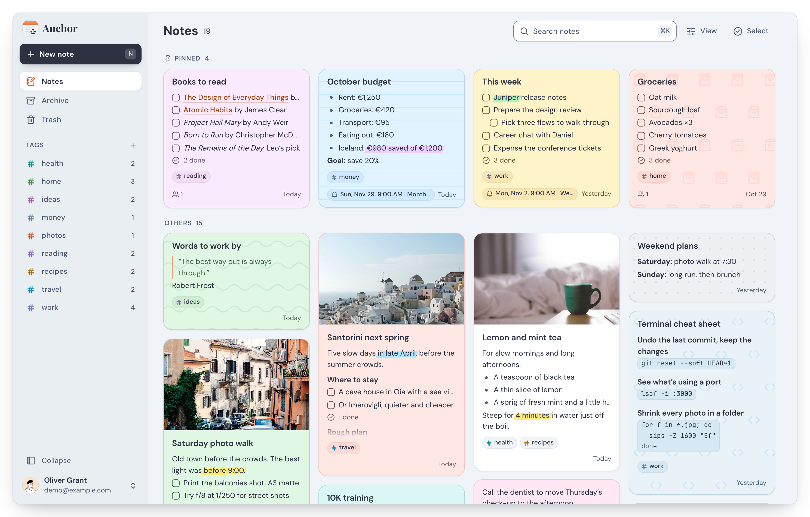
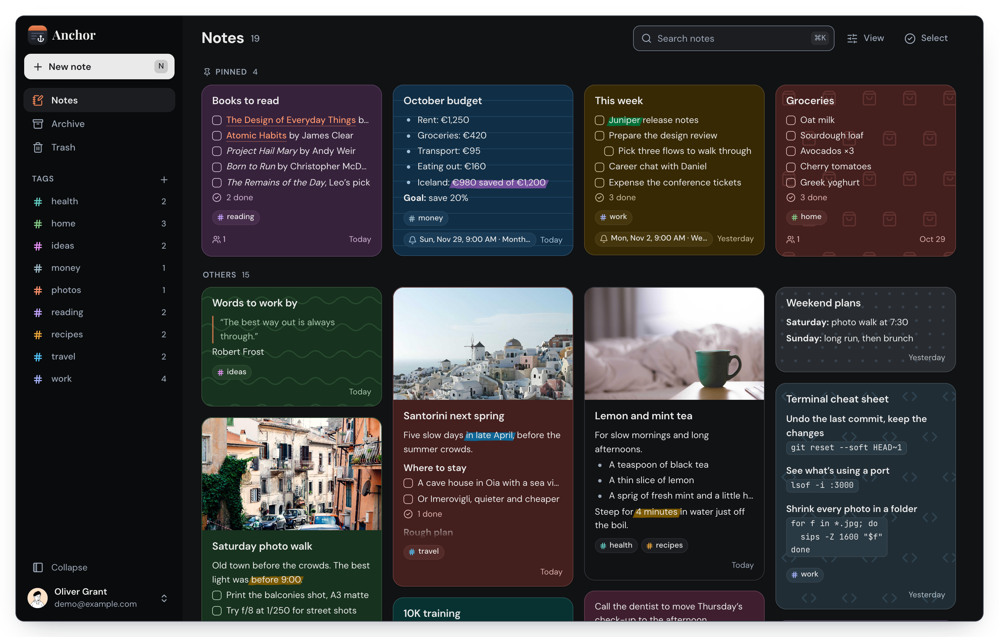

<div align="center">


# Anchor+

**An offline first, self hostable note taking application**

[](https://github.com/AlxndrJhn/anchor/releases)
[](LICENSE)
[](https://github.com/AlxndrJhn/anchor/pkgs/container/anchor)
[](https://discord.gg/sAfqjy8EYK)

<a href="https://trendshift.io/repositories/18646" target="_blank"></a>

Anchor focuses on speed, privacy, simplicity, and reliability across mobile and web. Notes are stored locally, editable offline, and synced across devices when online.

</div>

## Try it in your browser

Each release also publishes the web app on GitHub Pages, without a server:

- **[alxndrjhn.github.io/anchor](https://alxndrjhn.github.io/anchor/)**: the
  app itself. Your notes, tags and pictures stay in this browser (IndexedDB)
  and never leave it; Settings › Import and export backs them up.
- **[alxndrjhn.github.io/anchor/demo](https://alxndrjhn.github.io/anchor/demo/)**:
  a playground with sample notes, kept in memory only: a reload starts it
  over. Feature demos, in the sidebar, plays a short demo of each feature, after
  which it's yours to try; each has its own address, such as
  [/demo/freeze](https://alxndrjhn.github.io/anchor/demo/freeze).

Without a server there is no syncing, sharing, sign-in, API token or picture
search. To publish your own copy, set Settings › Pages › Source to "GitHub
Actions"; the workflow is `.github/workflows/pages.yml`, and
`BASE_PATH=/anchor pnpm build:pages` (in `web/`) builds the same site into
`web/out`.

## Anchor+ vs Anchor

Anchor+ is a fork of [ZhFahim/anchor](https://github.com/ZhFahim/anchor), kept up
to date with it, and works with any Anchor server. Everything upstream does,
Anchor+ does too; these are the differences. "Web" and "Android" say where each one is available.

| | Web | Android |
|---|:---:|:---:|
| **Notes and lists** | | |
| Drag notes to arrange them, as in Google Keep: the others make room as you drag, and a moved note stays put until it is edited again (Android: hold a card, then drag) | ✓ | ✓ |
| A Select button for choosing several notes; holding a card without moving still selects it | | ✓ |
| Make a copy of a note, with its pictures and attachments | ✓ | ✓ |
| Freeze a note: nobody can change, trash or delete it until its owner unfreezes it (freezing needs a connection) | ✓ | ✓ |
| Make a note invisible: it stays out of your lists and only a search finds it; filter by "Invisible" to list them | ✓ | ✓ |
| Send a note to other apps as text (checklists as ☐/☑) | ✓ | ✓ |
| Change the colour of many selected notes at once | ✓ | ✓ |
| Tick checklist items straight from the notes list ([#70](https://github.com/ZhFahim/anchor/issues/70)) | ✓ | ✓ |
| Show checkboxes / Hide checkboxes, Untick all, Delete ticked items | ✓ | ✓ |
| A new note opens with the cursor in its text | ✓ | ✓ |
| Delete without a confirmation, with Undo instead | (upstream) | ✓ |
| Archive a note without a confirmation: the archive button gets a dot, as the pin does, and archiving unpins | | ✓ |
| A new note can be pinned or archived before anything is written in it | | ✓ |
| Pinned and Others headings in the notes list | (upstream) | ✓ |
| Option to hide pictures on note cards ([#177](https://github.com/ZhFahim/anchor/issues/177)) | ✓ | ✓ |
| Empty the trash in one go | (upstream) | ✓ |
| Merge selected notes into the first one picked (Select notes › More), with Undo | | ✓ |
| Cards say Today and Yesterday, and add the year to dates from other years | | ✓ |
| Larger checkboxes on cards; ticking one no longer jolts the list | | ✓ |
| **Search** | | |
| Filters for colour, tag, pictures, checklists and reminders | ✓ | ✓ |
| Search with a regular expression, or matching case; a filter for notes that contain a secret (ids, keys and tokens, passwords) | | ✓ |
| Search finds the text in pictures (screenshots, receipts), read on the server | ✓ | ✓ |
| Opt-in: find notes by what their pictures show ("Katzen", "receipt"), in most languages, on your server | ✓ | ✓ |
| With that on, an opened picture can show what it depicts as tags (English or German); a tag searches for it | ✓ | ✓ |
| Search also finds archived notes; Archive and Trash can be searched ([#190](https://github.com/ZhFahim/anchor/issues/190)) | ✓ | ✓ |
| The searched words are marked in the note you open ([#134](https://github.com/ZhFahim/anchor/issues/134)) | ✓ | ✓ |
| The search is kept when you come back from a note ([#206](https://github.com/ZhFahim/anchor/issues/206)) | ✓ | ✓ |
| Tag counts include archived notes, and a tag lists them ([#114](https://github.com/ZhFahim/anchor/issues/114)) | ✓ | ✓ |
| Tags can be put in any order by dragging their handle; the order syncs | ✓ | ✓ |
| A tag's colour can be changed from its menu | ✓ | ✓ |
| Text colour, font (serif, monospace, Comic Sans, handwriting, typewriter, rounded, slab, marker) and highlights in any colour, picked or preset | ✓ | ✓ |
| A deleted note burns away like a destroyed card in Balatro, its last sparks fading out (off with reduced motion) | ✓ | ✓ |
| **Pictures, files and recordings** | | |
| Grab image text (OCR): marks the text on a picture to select (drag over words or draw a box), copy or insert in the note | ✓ | ✓ |
| Paste a picture to add it as an attachment | ✓ | ✓ |
| Click a card's picture to view it full size | ✓ | ✓ |
| Share a picture you're viewing, or copy it to the clipboard | | ✓ |
| Every picture is downloaded to the phone, so none waits for a connection | | ✓ |
| A picture pasted from the keyboard or with Paste picture goes into the text at the caret | | ✓ |
| Record audio straight into a note | ✓ | |
| Attach any kind of file; Android can also attach a whole folder, zipped | ✓ | ✓ |
| Add image, Take picture and Take several (one picture after another, without going back to the note) in an opened note's menu | | ✓ |
| Camera and pictures buttons left of the text styles put pictures in the text at the caret; drag a picture's corner to resize it, hold it to retake, crop, mirror, caption or delete it (web: a picture button, a corner that shows on hover, and right-click to replace, crop, mirror, caption or delete) | ✓ | ✓ |
| Download pictures and recordings ([#164](https://github.com/ZhFahim/anchor/issues/164)) | | ✓ |
| Share to Anchor from other apps: text, links, pictures, files ([#52](https://github.com/ZhFahim/anchor/issues/52)) | | ✓ |
| **History** | | |
| Each version shows its added (+) and removed (−) lines | ✓ | ✓ |
| **Offline** | | |
| Open, edit and create notes without a connection, even after a reload; changes sync when back online ([#202](https://github.com/ZhFahim/anchor/issues/202)) | ✓ | (upstream) |
| Back up every note, tag, picture and recording to a .zip file, and restore one: missing notes come back and sync up, notes already there are left alone (Settings › Backup) | | ✓ |
| **Reminders** | | |
| Done button on the reminder notification | | ✓ |
| **Appearance** | | |
| Colour schemes: Nord, Dracula, Solarized, Gruvbox, Catppuccin, Tokyo Night, One, Rosé Pine, Monokai, GitHub | ✓ | ✓ |
| OLED colour scheme: pure black in dark mode, near-black outlined cards, white text | ✓ | ✓ |
| Custom theme from JSON (Settings › Appearance), kept on the device; the same JSON works on both ([how](#custom-themes)) | ✓ | ✓ |
| Styles: Skeuomorphism, Neo-Brutalism and Lo-fi | ✓ | ✓ |
| A skeuomorphic app icon everywhere: Android (adaptive and themed), iOS, the splash screens, the in-app logo, the web app and its home-screen icons | ✓ | ✓ |
| **Getting around** | | |
| Google Keep keyboard shortcuts ([#201](https://github.com/ZhFahim/anchor/issues/201)) | ✓ | |
| Tab (web) or Next (Android) in the title goes to the note text | ✓ | ✓ |
| Insert today's date ("Oct 28th 2026"): type /date (then Enter on the web, a space or Enter on Android); on the web also Ctrl+; (or a shortcut of your own), Ctrl+Shift+; for the date and time, and a choice of "2026-10-28" instead (Settings › Editor) | ✓ | ✓ |
| Long-press the app icon: New note, New checklist | | ✓ |
| Hold the New Note button for New list | | ✓ |
| Double-tap the New Note button to paste the clipboard into a new note | | ✓ |
| Sign in on your phone without a password: the web's Settings › Sign in on your phone shows a QR code to scan from the app's first screen, or copies a magic link that opens the app and signs in (each works once, within 10 minutes) | ✓ | ✓ |
| Updates itself from this fork's GitHub releases (Settings › Updates) | | ✓ |
| Install and update it with F-Droid, from releases or also release candidates ([F-Droid](#f-droid)) | | ✓ |
| A new note gets the tag the list is filtered by | | ✓ |
| Back no longer closes the app by accident ([#136](https://github.com/ZhFahim/anchor/issues/136)); with a tag or filter on, it first shows all notes again | | ✓ |
| A chevron back to the top, two screens down the notes list | | ✓ |
| Starts faster: settings are read in one go while the splash shows | | ✓ |
| Debug mode: hold two fingers still for 3 s to film the app and its state, mark problems on a timeline and file them as a GitHub issue (see [mobile/README.md](mobile/README.md#debug-reports)) | | ✓ |
| The server's version in Settings › About | ✓ | |
| Back up the whole server with one command and restore it with another, onto a fresh or newer server (see [Backing Up the Server](#backing-up-the-server)), and every day with borgmatic ([how](#backing-up-with-borgmatic)) | ✓ | |
| Install the server with one command on a small Linux server, such as a free tier one, with HTTPS for your domain or a free hostname (see [One-Line Install on a Small Server](#one-line-install-on-a-small-server)) | ✓ | |
| Claude, and other apps that speak MCP, can search, read and write your notes through your server (see [Claude (MCP)](#claude-mcp)) | ✓ | |
| **Fixes** | | |
| Copying and saving the logs on Android ([#187](https://github.com/ZhFahim/anchor/issues/187), [#188](https://github.com/ZhFahim/anchor/issues/188)) | | ✓ |
| The notes list can scroll to the end with pinned notes and pictures | | ✓ |
| Next.js upgraded to 16.4.3 for security fixes | ✓ | |
| **Releases** | | |
| Running the "Release (fork)" workflow on `main` makes a release with the APK and a multi-arch Docker image (see [This Fork's Image](#this-forks-image)); the APK installs as "Anchor+" next to the official app | ✓ | ✓ |
| A desktop app for Windows and macOS: your server's web client in its own window, in every release, that updates itself (see [Desktop App](#desktop-app)) | ✓ | |
| When upstream makes a release or release candidate, Claude merges upstream's `main` into the fork and opens a PR with the conflicts resolved and the checks run (the "Upstream release" workflow) | ✓ | ✓ |

### Custom themes

Settings › Appearance › Custom theme takes a theme as JSON. Paste it and
press Apply; Reset removes it; "Copy current theme as JSON" puts the colours
you see now (scheme and custom theme together) in the box and on the
clipboard, to start from. The theme is kept on that device only, like the
other appearance settings, and the same JSON works on the web and on
Android.

A custom theme sits on top of the chosen colour scheme: any colour it leaves
out is the scheme's. Lo-fi keeps its own pencil greys, so a custom theme
waits until another style is picked.

```json
{
  "name": "Ink",
  "light": {
    "background": "#f4f1ea",
    "card": "#fffdf8",
    "sidebar": "#ebe6db",
    "muted": "#e6e0d3",
    "foreground": "#1f1d1a",
    "mutedForeground": "#5c574e",
    "accent": "#2f6fdd",
    "accentStrong": "#2459b8",
    "accentInk": "#1d4a99",
    "border": "#d6cfc1",
    "divider": "#e3ddd0",
    "input": "#8a8375",
    "destructive": "#b3261e"
  },
  "dark": {
    "background": "#000",
    "card": "#111111",
    "accent": "#7aa2f7",
    "border": "#ffffff26"
  }
}
```

| Key | Meaning |
|---|---|
| `name` | Optional. Shown in Settings and used by "Copy current theme as JSON" |
| `light`, `dark` | The colours for light and dark mode. At least one is needed; a mode left out is the scheme's own |
| `background` | The page behind everything |
| `card` | Note cards, menus, dialogs and settings cards; also a plain note's colour |
| `sidebar` | The sidebar on the web; the drawer on Android |
| `muted` | Quiet fills: inputs, chips, loading placeholders |
| `foreground` | Text and icons |
| `mutedForeground` | Secondary text: dates, hints, captions |
| `accent` | Highlights: the selection on the web, links on dark panels (toasts) |
| `accentStrong` | Focus rings, switches, the text cursor; the selection on Android |
| `accentInk` | Links and accent-coloured text, where it has to read as text |
| `border` | Card and control outlines |
| `divider` | Lines between rows |
| `input` | Text field outlines |
| `destructive` | Delete buttons and error messages |

Colours are `#rgb`, `#rrggbb` or `#rrggbbaa` (the last two hex digits are
opacity), in upper or lower case. Any other key, or anything else as a
colour, is refused with a message naming the key and what is wrong with it
(`dark.backgroud: unknown key (did you mean "background"?)`), and nothing
changes until the JSON is fixed. The keys are the fields of the built-in
schemes in `design/schemes/schemes.json`; the parsers are
`web/lib/design/custom-theme.ts` and `mobile/lib/core/theme/custom_theme.dart`.

## Features

- **Rich Text Editor** - Create and edit notes with powerful formatting (bold, italic, underline, headings, lists, checkboxes)
- **Offline First** - All edits work offline with local database
- **Note Sharing** - Share notes with other users (viewer or editor)
- **Note History** - Read earlier versions of a note and put one back
- **Tags System** - Organize notes with custom tags and colors
- **Attachments** - Attach images and audio to notes
- **Note Backgrounds** - Customize notes with solid colors and patterns
- **Pin Notes** - Pin important notes for quick access
- **Archive Notes** - Archive notes for later reference
- **Reminders** - Set a time on any note and get a notification on your phone, once or repeating
- **Search** - Search notes locally by title or content
- **Trash** - Soft delete notes with recovery period
- **Automatic Sync** - Sync changes across devices when online
- **Import & Export** - Back up your full library, or move notes in and out as plain Markdown
- **Home Screen Widget** - Quick access to your notes from the Android home screen
- **Admin Panel** - User management, registration control, and system statistics
- **OIDC Authentication** - Sign in with OpenID Connect providers (Pocket ID, Authelia, Keycloak, etc.)

## Screenshots

### Web App

<div align="center">
  
  
</div>

### Mobile App

<div align="center">
  
  
</div>

## Self Hosting With Docker

### One-Line Install on a Small Server

On a fresh Linux server, even the smallest free tier ones (Oracle Cloud's
E2.1.Micro and Ampere A1, AWS t2/t3/t4g.micro, Google Cloud's e2-micro, a 1 GB
VPS), one command, run over SSH, sets up everything:

```bash
curl -fsSL https://raw.githubusercontent.com/AlxndrJhn/anchor/main/install.sh | sudo PORT=3000 bash
```

With a domain whose DNS points at the server, Anchor gets HTTPS (a Let's
Encrypt certificate, through Caddy) on ports 80 and 443:

```bash
curl -fsSL https://raw.githubusercontent.com/AlxndrJhn/anchor/main/install.sh | sudo DOMAIN=notes.example.com bash
```

Without a domain of your own, `DOMAIN=sslip.io` takes a free hostname that
maps to the server's IP, such as `203-0-113-7.sslip.io` for `203.0.113.7`
(from [sslip.io](https://sslip.io)), and gets HTTPS for it the same way:

```bash
curl -fsSL https://raw.githubusercontent.com/AlxndrJhn/anchor/main/install.sh | sudo DOMAIN=sslip.io bash
```

The script finds the IP again on every run, so if the server gets a new one,
running it again moves Anchor to the new hostname (the apps then need the new
address). `DOMAIN=nip.io` does the same with nip.io, should Let's Encrypt's
limit for sslip.io be reached.

It works on Ubuntu, Debian, Oracle Linux, Rocky, Alma, RHEL, Fedora, Amazon
Linux and Arch (also Manjaro and EndeavourOS), on amd64 and arm64. It
installs Docker if it's missing (on Arch, after updating the system; reboot
and run it again if that brings a new kernel), adds 2 GB of swap when the
server has less than 2 GB of memory (and turns off search by what pictures
show, whose model needs more), opens the port in the server's own firewall,
and runs Anchor from `/opt/anchor` with a random database password. Sign up
right away: the first account is the admin.

Your cloud's firewall has to let the port in too (3000, or 80 and 443 with a
domain or sslip.io): on Oracle Cloud an ingress rule in the subnet's security
list, on AWS the instance's security group, on Google Cloud a VPC firewall
rule. Or leave it closed and serve Anchor over HTTPS for free with a
[Cloudflare Tunnel](https://developers.cloudflare.com/cloudflare-one/networks/connectors/cloudflare-tunnel/)
to `http://localhost:3000`.

Running the same command again updates Anchor and keeps the notes and the
domain. `PORT` is the port Anchor listens on without a domain, e.g.
`PORT=8080`; `DOMAIN=` (empty) goes back to plain HTTP;
`ANCHOR_TAG=fork-preview` follows the release candidates.
Anchor's own settings (see the table below) go in `/opt/anchor/anchor.env`,
followed by `docker compose up -d` in `/opt/anchor`.

### Option 1: Using Pre-built Image (Recommended)

1. **Create a `docker-compose.yml` file:**

   ```yaml
   services:
     anchor-plus:
       image: ghcr.io/alxndrjhn/anchor:fork-latest
       container_name: anchor-plus
       restart: unless-stopped
       ports:
         - "3000:3000"
       volumes:
         - anchor_plus_data:/data

   volumes:
     anchor_plus_data:
   ```

2. **(Optional) Configure environment:**
   Add environment variables to the `environment` section. Most users can skip this step - defaults work out of the box.

   Available options:
   | Variable | Required | Default | Description |
   |----------|----------|---------|-------------|
   | `APP_URL` | No | `http://localhost:3000` | Base URL where Anchor is served |
   | `JWT_SECRET` | No | (auto-generated) | Auth token secret. Min 16 characters when set |
   | `DATA_DIR` | No | `/data` | Root directory for persisted uploads |
   | `PICTURE_TEXT` | No | `on` | `off` stops reading the text in pictures for search |
   | `PICTURE_SEARCH` | No | `on` | `off` stops offering search by what pictures show (Settings › Search) |
   | `PICTURE_SEARCH_MODEL_URL` | No | (Hugging Face) | Where to download its model (~380 MB) from, e.g. a mirror |
   | `HEARTBEAT_URL` | No | — | URL to call while the server works, e.g. an Uptime Kuma push URL (see [Monitoring](#monitoring-the-server)) |
   | `HEARTBEAT_INTERVAL` | No | `60` | Seconds between those calls (10 or more) |
   | `CORS_ORIGINS` | No | (allow all) | Comma-separated allowlist of CORS origins |
   | `PG_HOST` | No | (empty) | External Postgres host (leave empty for embedded) |
   | `PG_PORT` | No | `5432` | Postgres port |
   | `PG_USER` | No | `anchor` | Postgres username |
   | `PG_PASSWORD` | No | `password` | Postgres password |
   | `PG_DATABASE` | No | `anchor` | Database name |
   | `USER_SIGNUP` | No | (not set) | Sign up mode: `disabled`, `enabled`, or `review`. If not set, admins can control it via the admin panel |
   | `OIDC_ENABLED` | No | — | Enable OIDC authentication |
   | `OIDC_PROVIDER_NAME` | No | `"OIDC Provider"` | Display name for the login button |
   | `OIDC_ISSUER_URL` | When OIDC enabled | — | Base URL of your OIDC provider |
   | `OIDC_CLIENT_ID` | When OIDC enabled | — | OIDC client ID |
   | `OIDC_CLIENT_SECRET` | No | — | OIDC client secret. Omit for public client (PKCE) |
   | `DISABLE_INTERNAL_AUTH` | No | `false` | Hide local login form when OIDC is enabled (OIDC-only mode) |

3. **Start the container:**

   ```bash
   docker compose up -d
   ```

4. **Access the app:**
   Open http://localhost:3000

5. **Update later:**

   ```bash
   docker compose pull && docker compose up -d
   ```

   Your data lives in the `anchor_plus_data` volume, which updates (and
   `--force-recreate`) keep. Run them from the same folder each time: the
   volume is named after it. Before a release changes the database, Anchor
   saves it to `/data/backups` (the last 3 are kept). Only
   `docker compose down -v` deletes the volume.

   The container and the volume are named `anchor-plus` and
   `anchor_plus_data`, not `anchor` and `anchor_data` like the original
   Anchor's, so both can run on one server (on different ports). A
   `docker-compose.yml` from before that still names them `anchor`; to move
   to the new names, back up with the old file, change it, and restore:

   ```bash
   docker compose exec -T anchor backup > anchor-backup.tar
   docker compose down
   # in docker-compose.yml: anchor -> anchor-plus, anchor_data -> anchor_plus_data
   docker compose up -d
   docker compose exec -T anchor-plus restore < anchor-backup.tar
   ```

   The old volume is kept until you delete it (`docker volume ls`, then
   `docker volume rm <folder>_anchor_data`). The one-line install moves
   itself.

### Image Tags

Every release of this fork is named `fork-<version>.<build>` and publishes a
multi-arch image (amd64 and arm64, so it runs on a Raspberry Pi 5):

| Tag | What it is |
|-----|------------|
| `ghcr.io/alxndrjhn/anchor:fork-latest` | The newest release |
| `ghcr.io/alxndrjhn/anchor:fork-<version>.<build>` | One release, e.g. `fork-0.17.2.36`, to stay on it |
| `ghcr.io/alxndrjhn/anchor:fork-<commit>` | The build of one commit |
| `ghcr.io/alxndrjhn/anchor:fork-preview` | The newest release candidate, or release if newer. With it, apps that have *Receive preview releases* on in their settings also update to release candidates |

The original project's image is `ghcr.io/zhfahim/anchor:latest`; it has none
of this fork's changes. A server can go back to it and return to Anchor+
later, keeping every note: see
[Switching Back to Anchor](#switching-back-to-anchor).

### Option 2: Building from Source

If you want to build from source or customize the image:

1. **Clone the project:**

   ```bash
   git clone https://github.com/AlxndrJhn/anchor.git
   cd anchor
   ```

2. **Build and start the container:**

   ```bash
   docker compose up -d --build
   ```

   `--build` builds the image from your checkout; without it, the
   `docker-compose.yml` file pulls this fork's released image.

### Resetting a Password

Whoever can run `docker` on the host can set a new password for any
account, admins included, without signing in. List the accounts:

```bash
docker exec -it anchor-plus reset-password
```

Give one a new, generated password, which the command prints:

```bash
docker exec -it anchor-plus reset-password user@example.com
```

Or type the new password yourself (at least 8 characters, not echoed):

```bash
docker exec -it anchor-plus reset-password user@example.com --password
```

`anchor-plus` is the `container_name`; with Docker Compose you can also run
`docker compose exec anchor-plus reset-password …` from the folder with the
`docker-compose.yml`. The user signs in with the new password right away;
devices that are already signed in stay signed in.

### Backing Up the Server

One command, in the folder with the `docker-compose.yml`, backs up the
whole server: every account, note, tag, revision and setting, every
picture, recording and file, and the secret sign-ins are signed with.
Anchor keeps running while it's made, and it takes seconds:

```bash
docker compose exec -T anchor-plus backup > anchor-backup-$(date +%F).tar
```

One command restores it, on this server or on a fresh one, even one on a
later release, whose database it brings up to date. It replaces everything
on that server, then Anchor restarts, and the apps stay signed in:

```bash
docker compose exec -T anchor-plus restore < anchor-backup-2026-10-31.tar
```

On a new server, start Anchor first (`docker compose up -d`), then restore.
Keep the `-T`: a terminal would garble the backup, so without it the
commands stop and say so. The database is saved as a
`pg_dump`, so a backup also works with a later Postgres. The picture search
model is left out; it's downloaded again when it's needed. Keep backups
somewhere safe: whoever has one can read every note and sign in as anyone.
In PowerShell, `>` and `<` need PowerShell 7.4 or later.

### Backing Up with borgmatic

[borgmatic](https://torsion.org/borgmatic/) runs that backup every day and
keeps it with [Borg](https://www.borgbackup.org/): encrypted, on another disk
or a Borg server over SSH, with pictures and files that didn't change stored
only once. The [`borgmatic.yaml`](borgmatic.yaml) in this repository is all
it needs (borgmatic 2.0 or later). As root on the server:

1. **Get the configuration** and set the repository and a passphrase in it:

   ```bash
   mkdir -p /etc/borgmatic.d
   curl -fsSL https://raw.githubusercontent.com/AlxndrJhn/anchor/main/borgmatic.yaml -o /etc/borgmatic.d/anchor.yaml
   chmod 600 /etc/borgmatic.d/anchor.yaml
   nano /etc/borgmatic.d/anchor.yaml
   ```

2. **Create the repository**, then make the first backup:

   ```bash
   borgmatic repo-create --encryption repokey-blake2
   borgmatic create --verbosity 1 --list --stats
   ```

3. **Back up every day**: borgmatic's packages come with a systemd timer
   (`systemctl enable --now borgmatic.timer`); otherwise a cron line does
   it, e.g. `0 3 * * * root borgmatic` in `/etc/cron.d/borgmatic`.

Each run writes the backup to `/var/backups/anchor`, archives it and deletes
it again, then drops the archives the `keep_` settings don't keep (7 daily,
4 weekly, 6 monthly). Keep the passphrase and, with `repokey`, an export of
the key (`borgmatic key export`) off the server: without them, the backups
can't be read.

To restore, take the backup out of the newest archive (or another, from
`borgmatic repo-list`) and give it to `restore` as above:

```bash
mkdir -p /tmp/anchor-restore
borgmatic extract --archive latest --path var/backups/anchor/anchor-backup.tar --destination /tmp/anchor-restore
docker exec -i anchor-plus restore < /tmp/anchor-restore/var/backups/anchor/anchor-backup.tar
rm -rf /tmp/anchor-restore
```

### Switching Back to Anchor

A server can go back to the original Anchor image and come back to Anchor+
later without losing a note. What only Anchor+ has stays in the database,
unused by the original, and works again on switching back; changes made in
between come along. Each change of this fork's is tested this way, and the
original's newest image is tried every week.

First see what works differently until you return (files attached, locked,
invisible and frozen notes, share links, formatting the original can't
show):

```bash
docker compose exec anchor-plus switch-check
```

Then:

1. Let every app sync: changes a device hasn't sent yet stay on it.
2. Back up: `docker compose exec -T anchor-plus backup > anchor-backup-$(date +%F).tar`
3. Set `image:` in `docker-compose.yml` to `ghcr.io/zhfahim/anchor:latest`,
   then `docker compose up -d`.
4. On Android, install the original app; it installs next to Anchor+. Sign
   in, check your notes are there, then uninstall Anchor+.
5. In each browser, clear the site's data once its notes have synced, so
   Anchor+'s offline copy of the web app makes way for the original.

To return, set the image back to `ghcr.io/alxndrjhn/anchor:fork-latest`.
Editing a note in the original removes what it can't show (text colours,
fonts, custom highlights, pictures placed in the text), and that stays
removed.

### Monitoring the Server

Uptime Kuma, Gatus, Healthchecks.io, Better Stack and the like can tell you
when Anchor goes down, in one of two ways.

**The monitor checks Anchor.** Add an HTTP monitor for

```
https://notes.example.com/api/health/ready
```

It answers 200 while Anchor and its database work, and 503 when the
database doesn't answer, so the monitor goes down both when the server is
unreachable and when it can't serve notes. In Uptime Kuma: *Add New Monitor ›
HTTP(s)*, paste the URL, done. It needs no account or token and says nothing
about your notes. If Uptime Kuma runs on the same Docker host, a *Docker
Container* monitor on `anchor-plus` works too: the image's health check uses the
same endpoint.

**Anchor checks in with the monitor.** When the monitor can't reach Anchor,
say Anchor runs at home behind a router, let Anchor call it instead. In
Uptime Kuma, *Add New Monitor › Push* gives a push URL; set it as
`HEARTBEAT_URL`:

```yaml
    environment:
      - HEARTBEAT_URL=https://kuma.example.com/api/push/AbC123?status=up&msg=OK&ping=
```

Anchor then calls it every minute (`HEARTBEAT_INTERVAL`, in seconds) while
its database works, and the monitor goes down when the calls stop. Give the
monitor a heartbeat interval a little longer than Anchor's. A
Healthchecks.io ping URL, or any other URL that a GET checks in to, works
the same way.

## Mobile App

Download the Android mobile app.

1. **Visit the releases page:**
   Go to [GitHub Releases](https://github.com/AlxndrJhn/anchor/releases).
   A release that changed nothing for Android has no APK; its notes link to
   the release with the current one.

2. **Download the latest release:**
   Each release has one APK per kind of phone:
   - **`anchor-fork.apk`** - 64-bit ARM, for nearly every phone
   - **`anchor-fork-armeabi-v7a.apk`** - older 32-bit ARM phones
   - **`anchor-fork-x86_64.apk`** - emulators and x86 devices

   Once installed, the app finds and installs new releases itself
   (Settings › Updates).

After fork-0.18.0.69, Anchor+ is `com.alxndrjhn.anchorplus` on Android;
before, it was `com.zhfahim.anchor.fork`. Android sees them as two apps, so
the new one installs next to the old one instead of updating it. Sign in to
your server in the new one, check your notes are there, then uninstall the old
one: notes that never synced live only in the old one.

### F-Droid

This fork has two F-Droid repositories, on its GitHub Pages site. Open
**[alxndrjhn.github.io/anchor/fdroid](https://alxndrjhn.github.io/anchor/fdroid/)**
on your phone and tap the one you want, or add its address in F-Droid under
Settings › Repositories › +:

| Repository | Has |
|---|---|
| **Anchor+** (`…/anchor/fdroid/repo`) | The releases |
| **Anchor+ preview** (`…/anchor/fdroid/preview/repo`) | The releases and release candidates, whichever is newer |

Both are signed with the key whose SHA-256 fingerprint is
`fa9401f1622731a89771e284c7b9df7676e55eab79fb5c6c009e3f2c9f873f24`; the links
on that page carry it, so F-Droid accepts no other.

Then install Anchor+ from it. To switch, turn one off and the other on under
Settings › Repositories. Leaving preview waits for the next release, as F-Droid
doesn't install an older version over a newer one.

They hold the same APKs as the GitHub releases, signed with the same key, so
F-Droid updates an Anchor+ installed from GitHub too, and the other way round.
Installed by F-Droid, the app doesn't show its own Update available banner;
Settings › Updates still checks when asked.

Anchor+ isn't in F-Droid's own store yet. For that F-Droid builds it from
source, without Google's ML Kit and so without "Grab image text":
`mobile/tool/fdroid_prebuild.sh` makes a checkout that build, and
`.github/fdroid/fdroiddata/` has the recipe to send to F-Droid, and how it works.

## Desktop App

A Windows and macOS app that opens the web client of your own Anchor server in
its own window, with everything the web app has (offline use, keyboard
shortcuts). It does not store notes itself; it connects to your server.

1. **Download it** from this fork's
   [releases page](https://github.com/AlxndrJhn/anchor/releases):
   - **Windows:** `Anchor-Setup-<version>.exe` (64-bit)
   - **macOS:** `Anchor-<version>-universal.dmg` (Apple silicon and Intel);
     open it and drag Anchor+ to Applications

2. **Connect:** on first launch, enter the address you open Anchor+ at in your
   browser, such as `https://notes.example.com`. The app checks that the server
   answers, then remembers it. **Change server…** (File menu on Windows, the
   Anchor+ menu on macOS) switches to another one.

The builds are not signed, so the system warns the first time:

- **macOS:** right-click Anchor in Applications and choose **Open**, then
  **Open** again; or try to open it once, then allow it under **System
  Settings › Privacy & Security** (**Open Anyway**).
- **Windows:** if SmartScreen says it protected your PC, choose
  **More info › Run anyway**.

The app keeps itself up to date: it looks for a newer release now and then,
downloads it in the background, and then shows a small **Update** button in
the top right (also **Restart to Update** in the File menu, or the Anchor+ menu
on macOS). Clicking it restarts Anchor+ on the new version. On macOS this needs
Anchor+ in a folder you can write to, such as Applications; run from the disk
image, the button opens the release page instead.

Links to other websites open in your browser. To build it yourself:
`cd desktop && pnpm install && pnpm run dist:win` (or `dist:mac`).

## Claude (MCP)

The server speaks the [Model Context Protocol](https://modelcontextprotocol.io)
at `/api/mcp`, so Claude can search, read and write your notes. It signs in
with your API token: copy it from Settings › API token in the web app.

With [Claude Code](https://code.claude.com), replace the address and token:

```bash
claude mcp add --transport http --scope user anchor https://notes.example.com/api/mcp --header "Authorization: Bearer YOUR_API_TOKEN"
```

With Claude Desktop, add this to its `claude_desktop_config.json` (Settings ›
Developer › Edit Config) and restart it; it needs Node.js for `npx`:

```json
{
  "mcpServers": {
    "anchor": {
      "command": "npx",
      "args": [
        "-y",
        "mcp-remote",
        "https://notes.example.com/api/mcp",
        "--header",
        "Authorization:${ANCHOR_AUTH}"
      ],
      "env": { "ANCHOR_AUTH": "Bearer YOUR_API_TOKEN" }
    }
  }
}
```

Claude gets these tools, and sees only what your account sees:

| Tool | What it does |
|---|---|
| `list_notes` | Lists notes, archived ones or the trash, by search or tag |
| `get_note` | Reads a note's title, tags and text as Markdown, and lists its attachments |
| `get_attachment` | Fetches an attachment: a picture to look at (scaled down if large), a recording, or a file |
| `list_tags` | Lists your tags |
| `create_note` | Makes a note from Markdown, with tags (new ones are created) |
| `update_note` | Changes a note's title, text, tags, pin or archive |
| `append_to_note` | Adds lines to the end of a note, such as checklist items |
| `trash_note` | Moves a note to the trash, from where it can be restored |

Notes are written as Markdown: headings, lists, checklists (`- [ ] item`),
bold, italic, `~~strike~~`, `<u>underline</u>`, `==highlight==`, links,
quotes and code blocks. Locked notes keep their text and attachments from
Claude, and the
text of a note with pictures in it, colours or fonts is never replaced, only
added to, so nothing Markdown can't carry is lost. A change made from a stale
copy is refused, as in the apps, and every change shows in the note's history.
Revoking the API token cuts Claude off.

## OIDC Authentication

Anchor supports OpenID Connect (OIDC) authentication for simplified credential management and streamlined multi-user deployments.

### Features

- Support for standard OIDC providers (Pocket ID, Authelia, Authentik, Keycloak, etc.)
- Configuration via environment variables or admin settings UI
- OIDC only mode: disable local username/password login
- Support for public OIDC clients (PKCE, no client secret required)
- Auto create users on first login (if user signup is not disabled)
- Auto link existing users by email

### Configuration

#### Mobile app and Public client

If you want to use OIDC in the mobile app, configure Anchor as a **Public client** (PKCE, no client secret) in your OIDC provider. Add this redirect URI in your OIDC provider:

```
anchor://oidc/callback
```

#### Required Callback URL (Web)

When configuring your OIDC provider for web login, add this callback/redirect URL:

```
{APP_URL}/api/auth/oidc/callback
```

For example, if your Anchor instance is at `https://notes.example.com`, the callback URL would be:

```
https://notes.example.com/api/auth/oidc/callback
```

#### Environment Variables

Configure OIDC via environment variables in your `docker-compose.yml`. Pocket ID example:

```yaml
services:
  anchor-plus:
    image: ghcr.io/alxndrjhn/anchor:fork-latest
    environment:
      - OIDC_ENABLED=true
      - OIDC_PROVIDER_NAME=Pocket ID
      - OIDC_ISSUER_URL=https://pocketid.example.com
      - OIDC_CLIENT_ID=your-client-id
      - OIDC_CLIENT_SECRET=your-client-secret # Optional for public clients
      - DISABLE_INTERNAL_AUTH=false
      - APP_URL=https://notes.example.com
```

#### Admin UI Configuration

Alternatively, configure OIDC via the admin panel (Settings → OIDC Authentication) when the three env vars are not all set.

## Keyboard Shortcuts (Web)

Modelled on Google Keep. Single keys work when no text field has focus.

| Where | Key | Action |
|---|---|---|
| Note lists | `C` | New note |
| | `L` | New checklist |
| | `/` or `Ctrl/⌘ K` | Search |
| | `Ctrl/⌘ A` | Select all notes |
| Open note | `E` | Archive / unarchive |
| | `#` | Move to trash |
| | `F` | Pin / unpin |
| | `Esc` | Close the note (in a text field, the first `Esc` leaves the field) |
| | `Ctrl/⌘ Enter` | Close the note, from anywhere |
| In the text | `Ctrl/⌘ Shift 8` | Checklist on / off |
| | `Ctrl/⌘ ]` / `Ctrl/⌘ [` | Indent / outdent list item |
| | `Tab` in the title | Jump to the note text |

## Backup and Restore

To back up the whole server (all accounts) and move it to another, see
[Backing Up the Server](#backing-up-the-server). To export your own notes:

Log into your Anchor deployment, go to **Settings**, scroll to **Export & Import** and export **Anchor backup (.zip)**.

The resulting `anchor-export-YYYY-MM-DD.zip` contains:

- `manifest.json` which includes the backup metadata, tags, notes, and attachment references in plain text
- the referenced attachments, stored within the `attachments` folder structure

Restore the notes by uploading that file through the web UI. Go to **Settings**, then scroll down to the **Export & Import** section.

## Troubleshooting & Collecting Logs

Anchor never collects any data. When you need to report a bug, you can collect logs yourself and share them with the maintainer.

**Mobile app**

1. Reproduce the issue.
2. Open Settings → View Logs.
3. Tap the **Export** button at the bottom, then share the saved `.log` file in your bug report.

> Sensitive values are stripped before anything is written to the log file. This includes authorization headers, passwords, tokens, refresh tokens, secrets, and email addresses, which are always replaced with `***`.

Logs are stored locally on the device only (rolling, ~2 MB max).

## Roadmap

Future planned features:

- Real-time collaboration

## Tech Stack

- **Backend**: Nest.js, PostgreSQL, Prisma
- **Mobile**: Flutter
- **Web**: Next.js, TypeScript

## Contributing

1. Fork the repository
2. Create a feature branch:
   ```bash
   git checkout -b feature/your-feature
   ```
3. Make your changes
4. Ensure builds pass and code is linted:
   - Web: `cd web && pnpm build && pnpm check`
   - Server: `cd server && pnpm build && pnpm check`
5. Commit changes:
   ```bash
   git commit -m "Describe your change"
   ```
6. Push and create a Pull Request

### Code style

Linting and formatting are enforced in CI and by a pre-commit hook
(`.githooks/pre-commit`) that checks staged files.
Running `pnpm install` in either `web` or `server`
enables the hook automatically (via the `prepare` script). To enable it manually:

```bash
git config core.hooksPath .githooks
```

Before committing, fix issues with `pnpm check:fix` in the relevant project.

### Database migrations

A server has to be able to [switch back to Anchor](#switching-back-to-anchor),
so this fork's migrations make tables of their own and only add optional (or
defaulted) columns to the original's tables: no new values in its enums, no
renamed or dropped columns. CI checks it with
`cd server && node scripts/check-migrations.mjs upstream/main` (after
`git fetch upstream`), and `sh docker/test-switch-back.sh <image>` tries a
real switch and back.

### Design tokens

The web app's colors, text sizes, spacing, corners, shadows and motion live in
`design/tokens/` (W3C Design Tokens format). `web/app/styles/tokens.css`,
`web/app/styles/notes.css` and `web/lib/design/tokens.ts` are built from them,
so change the tokens rather than those files. After changing a token, run this
from the repository root (it reads icons from `web/node_modules`, so run
`pnpm install` in `web` first):

```bash
node design/build/build.mjs
```

CI runs it with `--check` and fails if the built files are out of date.

## Support

If you find Anchor useful, consider supporting its development:

[](https://www.buymeacoffee.com/zahid)

## License

This project is licensed under the GNU Affero General Public License v3.0 (AGPL v3) - see the [LICENSE](LICENSE) file for details.
